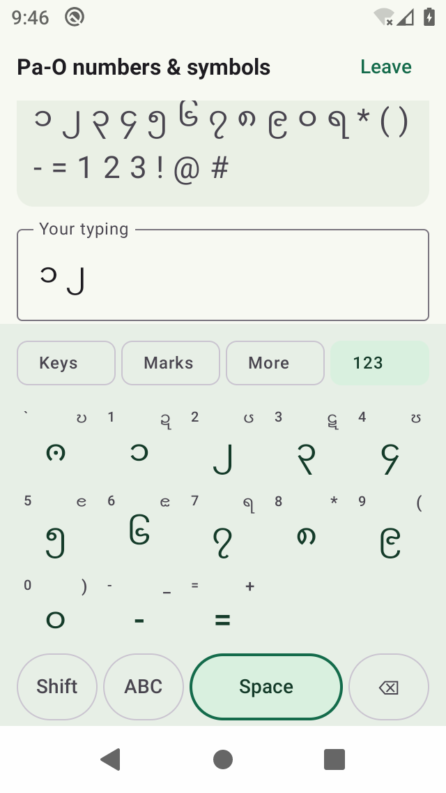

# Pa-O Typing Tutor — Android download

[Download the latest APK](https://github.com/kyawhla-commit/pa-oh-typing-tutor/raw/refs/heads/android-downloads/Pa-O-Typing-Tutor-0fa744e-debug.apk)

This test build includes all 47 keys from the supplied Pa-O layout, Pa-O digits,
Shift alternatives, desktop key labels, and an ABC switch for Latin letters and
symbols. A new numbers-and-symbols drill exercises the extra keys. Keypad taps
keep your typing visible above the controls, including on narrow phones.

Requires Android 7.0 or newer. Open the download link on your Android phone.
Once downloaded, open the APK from Downloads and follow the installation prompts.
If asked, allow installation from the browser or file manager you used.

This is a debug-signed preview for testing, not a Play Store release.
Source code lives on `master`; this branch stores downloadable builds.
Earlier APK files remain available through their existing links.

Source commit: [0fa744e](https://github.com/kyawhla-commit/pa-oh-typing-tutor/commit/0fa744ec7b5f8d58050d25311e68e51d6632f29f)

Validation: 20 unit tests and six UI tests passed on an API 29 emulator at
320 × 568 dp. The APK build, Android lint without errors, and signature checks
passed. Physical-phone comfort and third-party language keyboards still need
separate testing. The keypad uses direct Unicode outputs without automatic
syllable reordering.

SHA-256 checksums for downloadable APKs are in `SHA256SUMS`.
